# Content

## 1. Quote
"The way we tend to use resources is we extract them, we turn them into short-life products and then dispose of them. . . In ecosystems, the waste from one organism becomes the nutrient for something else in that system." 

Pawlyn, M. (2010), ‘Using Nature’s Genius in Architecture’, TEDSalon London.

## 2. CTA
- 1st iteration: 

> Learn from nature, leave no waste behind, repurpose what is already built.

- Final: 

> Learn from nature, be part of it, not apart from it.

After I presented it to my classmates and asked the teaching assistant for feedback, she said that the previous version did not clearly communicate the message. “Learn from nature” was fine, but the rest of the CTA was missing or unclear.

## 3. The connection between the quote and the SDG, with a call to action
"The way we tend to use resources is we extract them, we turn them into short-life products and then dispose of them. . . In ecosystems, the waste from one organism becomes the nutrient for something else in that system." Pawlyn, M. (2010), ‘Using Nature’s Genius in Architecture’, TEDSalon London.

   Michael Pawlyn, a British architect specialising in biomimicry and sustainable design, challenges in his TED talk the linear way we design, consume, and manage resources. He contrasts it with nature's circular model and argues that human development should become part of this model, built on interconnection, resource circulation and regeneration. This idea aligns with the United Nations' Sustainable Development Goal 11: Sustainable Cities and Communities, which calls for cities and human settlements to become inclusive, safe, resilient, and sustainable. This is not simply about building better cities, but about reflecting on how urban systems function and coexist with the natural environment. When these messages are overlooked, sustainability is easily misunderstood as simply humans consuming less and reducing damage, rather than as a system where people, infrastructure, resources and nature support one another. This project demonstrates the similarity between human systems and ecosystems to show that, rather than functioning as an isolated system, a living city should function as an interconnected living ecosystem, where resources circulate, communities cooperate and systems adapt to environmental change. “Learn from nature, be part of it, not apart from it” is the key to designing systems that can continuously support life.

## 4. Background Research

***a. Research***

***Problem Research***

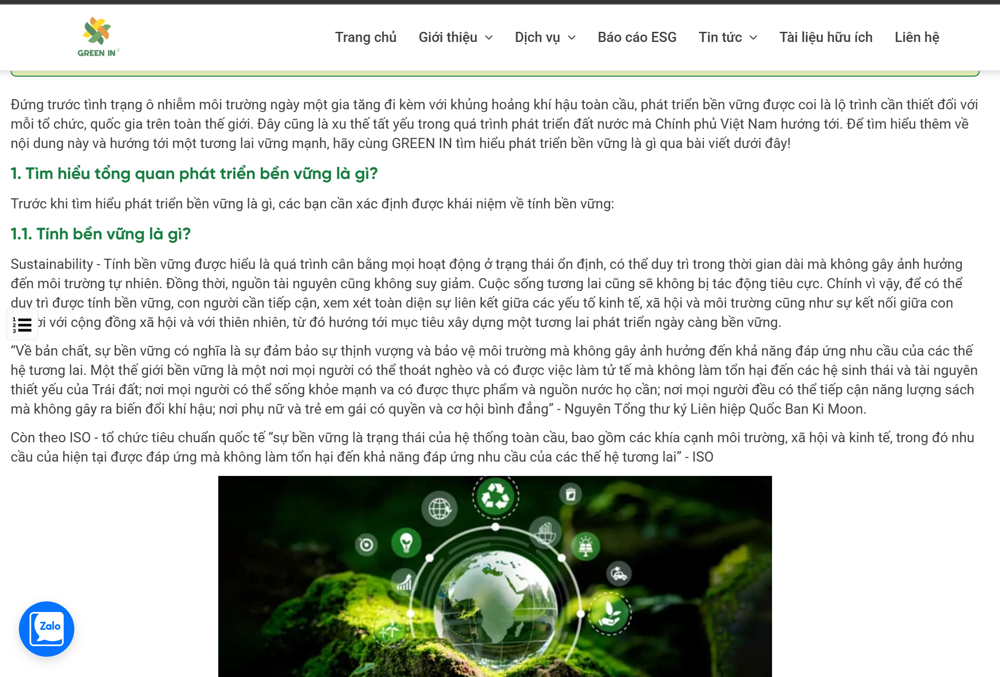
Figure: Research 

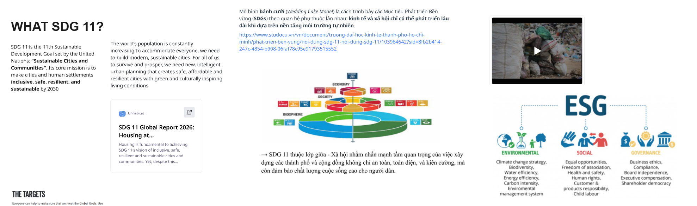
Figure: Research on SDG 11

To deeply understand what SDG 11 is and what its goals are, the first thing I did was look into the actual meaning of the terms “sustainable” and “sustainability”. They can be understood as maintaining a balance between activities in a stable state that can be sustained over a long period without harming the natural environment or depleting resources. At the same time, it ensures that future generations will not be negatively affected by our actions. The environment, people, and infrastructure should be interconnected and coexist harmoniously. However, the reality is that, despite some significant improvements, humans are still damaging nature and contributing to various social problems. Also, the words in SDG 11, such as “safe”, “inclusive”, and “sustainable”, each refer to different goals. Therefore, in the next iteration, I think our team should choose one of these words and focus on a specific area to develop further. The more specific the message is, the more relatable and tangible it will be to the audience.

Our team’s project does not directly present the problems and provide solutions, as we feel that this approach can be less inspiring and too direct, staying on a surface, theoretical level. Instead, we use “ecosystem” as a concept and metaphor to communicate the idea. By learning how an ecosystem functions, we hope people can understand and reflect on how a human system should operate in a similar way — through interconnectedness, coexistence, mutual support, and sustainability.

***Target Audience Research***

Indirect Target Audience: Global youth

Direct Target Audience: Vietnamese youth 

**Demographics**
- Gender: All genders
- Age: 18-35
- Students, interns, part-time workers and young professionals.
- Generally comfortable with smartphones, social media, digital platforms and interactive content.

**Geographic**
-	Highly urbanised metropolitan environment (HCM specifically)
- Areas facing waste management issues: plastic packaging, takeaway containers and household waste are common parts of daily consumption.
- Indirect impact at a global level.

**Behavioural**

While individuals within this audience vary in background, interests, and levels of engagement, they share a set of consistent behavioural patterns:
- Engage with topics around sustainability, environment, and human self-development.
- Prefer interactive and experiential content over explanatory or didactic formats
- Respond to relatable examples, visual metaphors, interactive experiences and practical actions.
- May recycle, reuse shopping bags, bring personal bottles or separate waste, but practices are not always consistent

**Psychographic**

This describes the audience's attitudes, values, motivations and frustrations.
- Generally interested in environmental issues but may not actively participate in sustainable practices
- They may feel that one person's actions cannot significantly change a city's environmental situation.

***b. Ideation***

This is a draft version of the ideation sketches I drew to visualise the concept. I am a storytelling-driven person, so all my sketches have a storytelling vibe. They may seem simple, but at this stage, I am not sure how much I can actually achieve through coding. The first sketch visualises a tree canopy, representing a resilient roof. The second is the final direction I developed further, as I want to show how every part of a living ecosystem is interconnected.

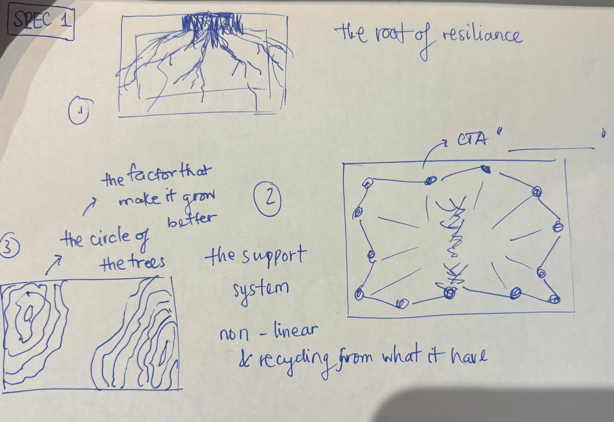
Figure: Thu's draft sketch

## 5. Concept
The interactive webpage focuses on developing a generative artwork about the UN’s SDG 11: Sustainable Cities and Communities, from the perspective of a living ecosystem. It explores how nature regenerates and recovers from damage by reusing the materials and resources within its surroundings. This creates a continuous cycle of regeneration, which contrasts with the one-way human process of make–use–waste.

Using the imagery and colour palette of a leaf as a metaphor (although it is not scientifically accurate that a leaf can regenerate tissue to heal a tear), I create a generative artwork that visualises this process, aiming to raise awareness of environmental adaptation, recycling, and regeneration. Just as a leaf relies on its ecosystem to heal and, in turn, helps heal others, a community relies on its environment and interconnected systems to recover, adapt and thrive to become resilient, safe and sustainable.

The main artwork page layout consists of two areas. The first focuses on the ability of natural plants to recover from damage by utilising elements from their surroundings. The second explores how plants support the growth of other surrounding organisms by utilising their leftover parts. Together, these two areas represent how a living ecosystem operates through coexistence, resource reuse, and regeneration, encouraging people to reflect on how we live and interact with our environment.

## 6. Moodboard & Visual Direction

***a. Visual***

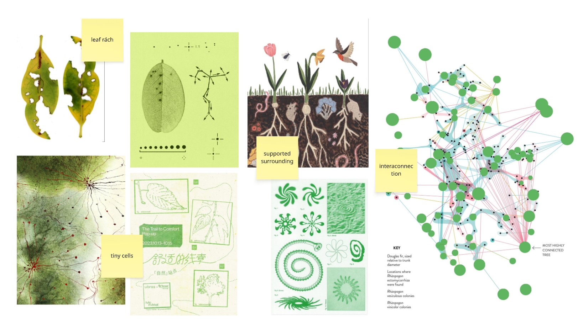
Figure 18. Thu's process visual.

***b. Colour***

When it comes to ecosystems, the colour palette is often biased towards green, yellow, and orange, creating an analogous colour scheme. I tend to use these predefined palettes, partly because they fit perfectly with my concept of “nature as the medium.” Colour can also express how I want people to receive the message, in a gentle way, while still encouraging them to reflect.

***c. Typography***

As a small part of the generative artwork, typography is not necessarily essential, but it can still have a subtle impact on the overall experience. I think a good typeface can somehow bring a certain vibe and feeling to people as they interact with the artwork. Therefore, to align with the soft, green, and calm atmosphere, the typeface should be sans-serif and rounded, with a casual, everyday feel. Sarabun is a humanist typeface that suits this direction; with its variable weights, it is also very readable for both headings and body text.

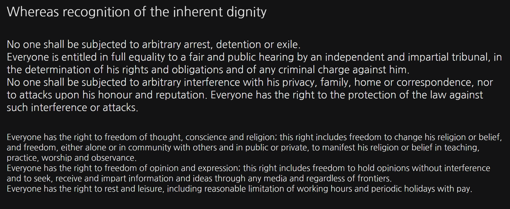
Fig: Thu's chosen typeface

## 7. Coding Process

***Technique***

Please note that I used AI to assist in converting the layout from a fixed resolution of 1920×1080 to a responsive width and height. Moreover, the functions were edited to be shorter than 20 lines, which helps me, as a beginner, understand each part easily.

<figure>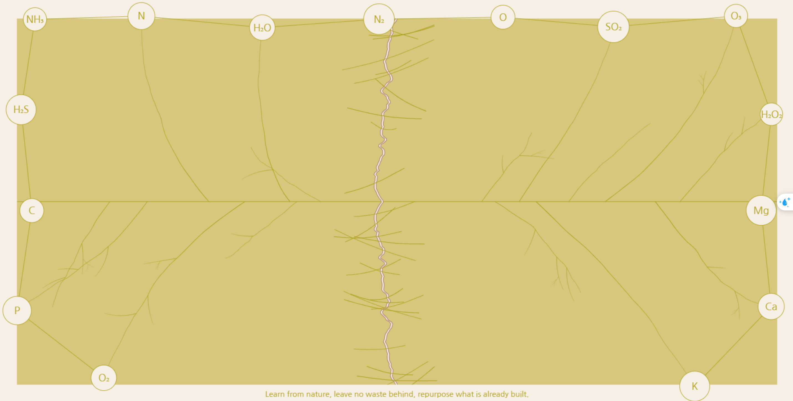<figcaption>Figure: p5js exploration before w4's presentation.</figcaption></figure>
<figure>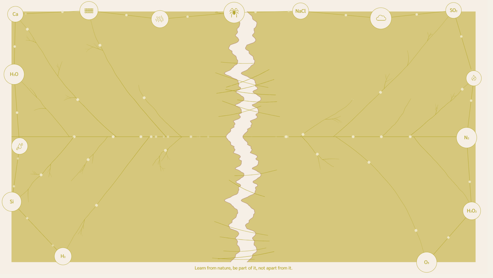<figcaption>Figure: p5js exploration after w4's review and comments</figcaption></figure>
<figure>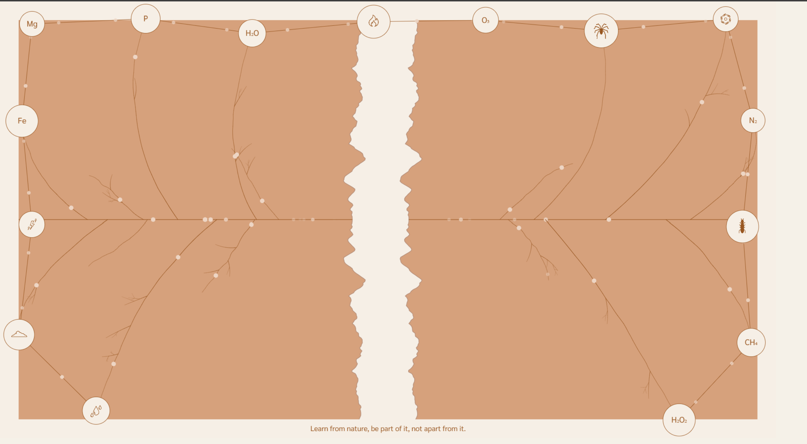<figcaption>Figure: p5js exploration after w4's review and comments</figcaption></figure>

***Iteration***

<figure>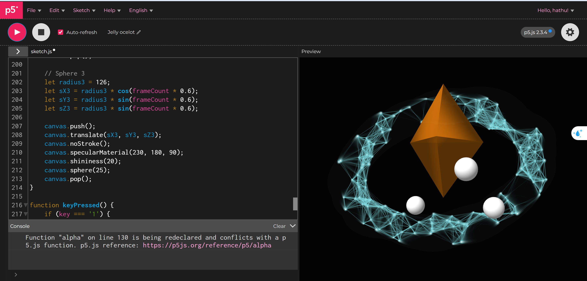<figcaption>Figure: Draft p5js exploration.</figcaption></figure>
<figure>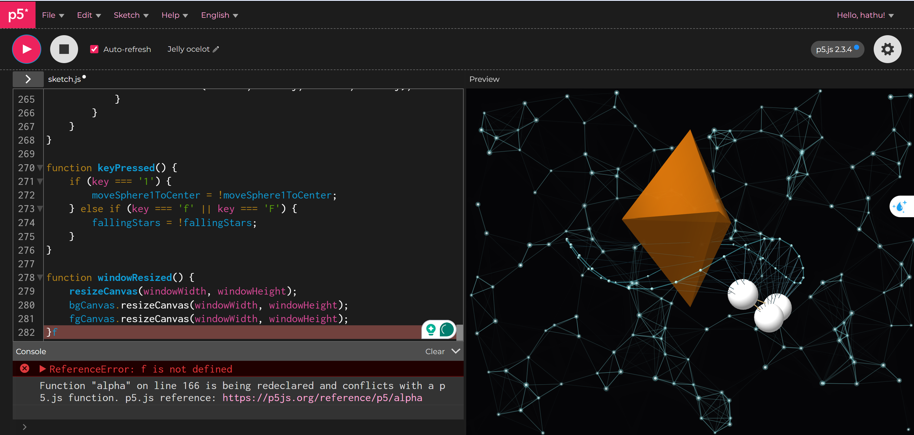<figcaption>Figure: Draft p5js exploration.</figcaption></figure>

Throughout the learning process, I had to go through many iterations to become more familiar with p5.js. I experimented with drawing 3D shapes in the p5.js editor, coding circles and ellipses, and creating simple animations. I also developed the first draft of the Element Bubble for the final project. Although the result was generative, the visual outcome was not quite what I had envisioned.

I am grateful for Claude's assistance, as it helped me solve many problems along the way. For example, I learned how to use `WEBGL` mode to create a 3D environment, how to make a circle move around an ellipse in 3D space, and how to connect points using lines.

***a. Pop-up intro Making***

For the intro, I coded it using HTML, CSS, and JavaScript to display all the information about the project. I used noLoop() to ensure that the pop-up only appears once and does not reappear when pressing R. I also coded the interaction so that when the pop-up is closed, the generative art starts running.

<figure>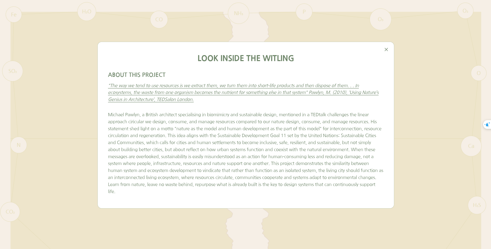<figcaption>Figure: 1st draft</figcaption></figure>
<figure>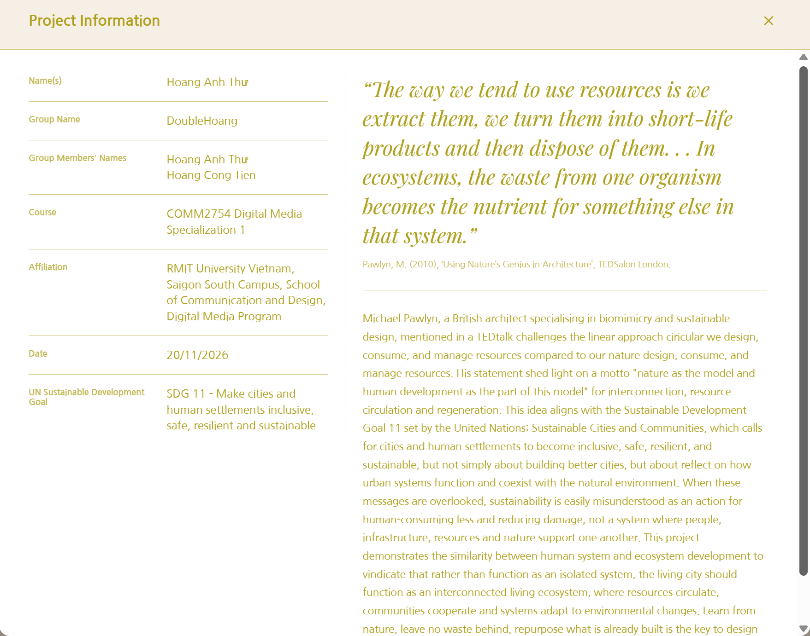<figcaption>Figure: Final</figcaption></figure>

I modified the pop-up code to make it more consistent with my teammate's design. I also repositioned it to the corner of the page so that users can open and read it whenever they want, rather than having it appear only the first time they enter the website and disappear afterwards.

***b. Bubbles, words & colour palettes***

I placed bubbles around the border using x, y and radius values. The bubbles represent the supporting elements in the surroundings. Each holds a chemical symbol (such as H₂O, CO₂ or O₂) or an image, chosen at random. I link them with lines in order around the edge, so the lines never overlap, and I leave a gap at the bottom for the message. The bubbles drift gently along the border with noise().

These words and icons are randomly assigned to the bubbles to represent the elements and substances involved in natural systems. I use shuffle() to randomly change the words inside the bubbles whenever the page reloads. This shows the variability of natural elements.

<figure>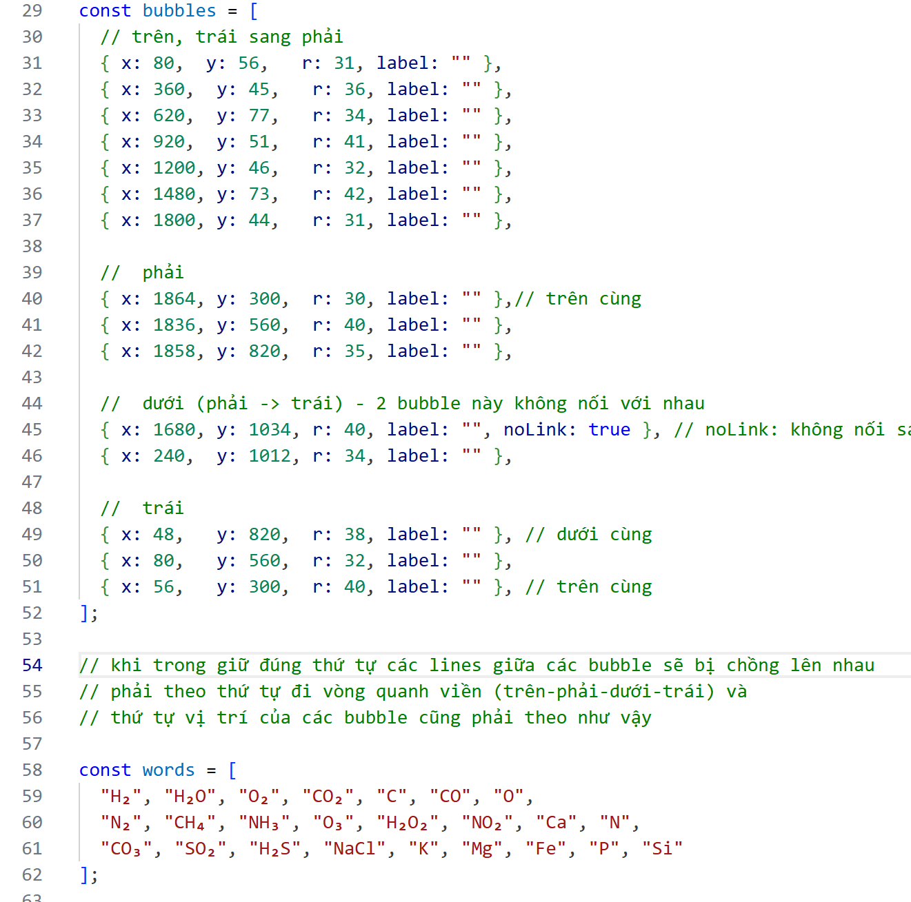<figcaption>Figure: Thu's coding process</figcaption></figure>
<figure>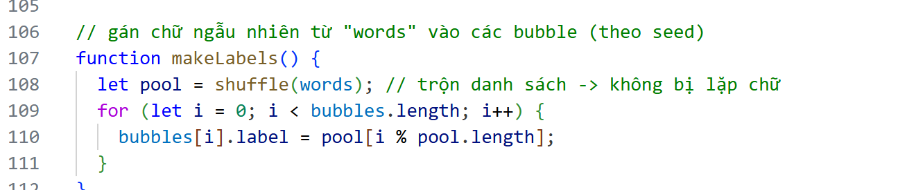<figcaption>Figure: Thu's coding process</figcaption></figure>

***c. Thread Making***

This is also a generative art thread that connects the two sides of the torn leaf. I made it to show how, thanks to nature, healing can happen. I use yA for the starting vertical position on the left and yB for the ending vertical position on the right to define its position. It sags in the middle with sin() and shakes a little with noise(), like a hand-drawn line.

<figure>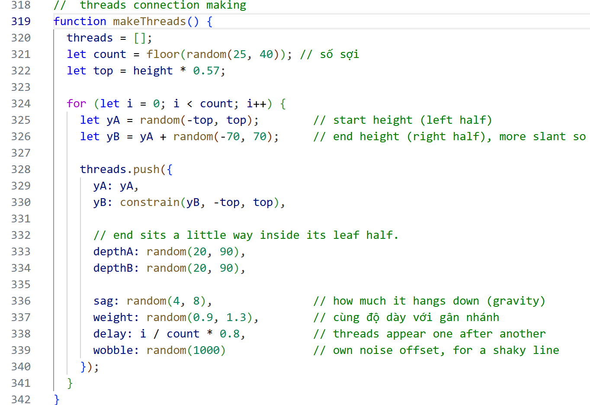<figcaption>Figure: Thu's coding process</figcaption></figure>

***d. Branch, Veins, BranchPoint, Twig, Twigs Making***

Functions to generate the leaf's branching structures and their geometry: makeVeins() → makeBranch() → branchControls() → branchPoints() → makeTwigs() → makeTwig() → twigPoints()

This was the hardest part for me to understand. I honestly couldn't have done it without Claude AI's help, and I have to admit that. However, studying, learning, and understanding the code are necessary for me to move forward.

- Make Branches (Bezier Curves)

This generates the geometry of an individual vein from its starting point to its destination. I build each vein as a cubic Bezier from the midrib to a bubble, sampled into 51 points. With the tangent, I push each point slightly sideways using noise, so the vein wobbles but still touches both ends.

<figure>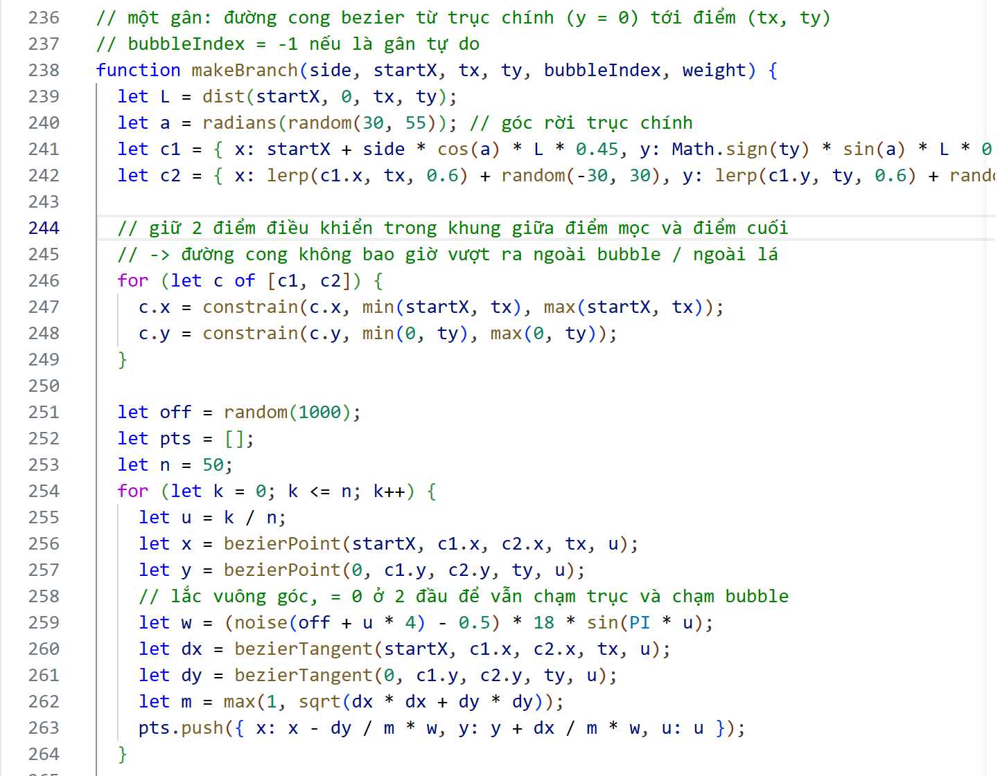<figcaption>Figure: Thu's coding process</figcaption></figure>

- Veins

This function controls the overall animation of the entire vein network. The use of constrain() limits the progress to between 0 and 1, so each vein can have an individual delay. 

<figure>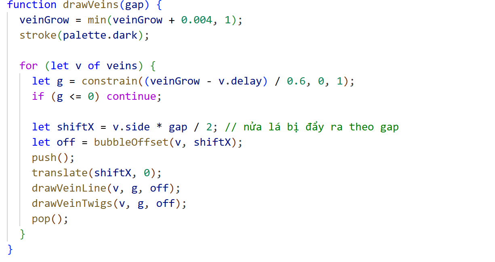<figcaption>Figure: Thu's coding process</figcaption></figure>

I wanted the ends of the veins to connect to the bubbles, so I used the BubbleOffset function. Its purpose is to let each bubble move while keeping the vein connected to it, by calculating the bubble's position offsets.

<figure>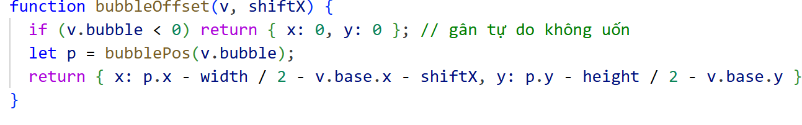<figcaption>Figure: Thu's coding process</figcaption></figure>

- Twig

This code creates a chained growth sequence: main vein → twig → child twig → smaller child twig.
The function drawVeinTwigs(v, g, off) makes sure that the twigs attached to a vein also receive the appropriate bubble movement adjustment.

<figure>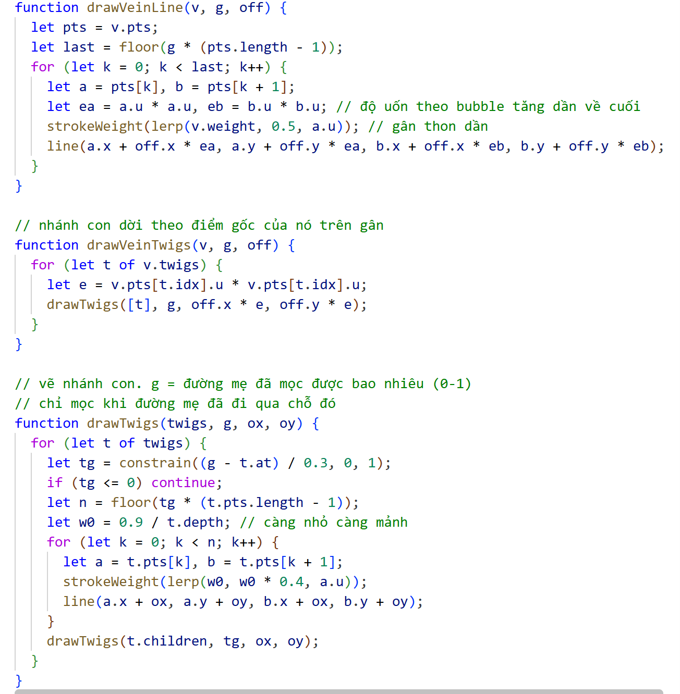<figcaption>Figure: Thu's coding process</figcaption></figure>

***e. Leaf Making***

To animate the wound closing, I draw the left and right halves of the leaf independently, allowing them to move toward the centre during the healing animation. The leaf shape is constructed using beginShape(), vertex(), and endShape(CLOSE).

To meet the requirement and make the code easier to learn, instead of placing all the leaf geometry in one large function, I divided it into:
- drawLeafShape() – body
- drawTearEdge() – wound edge
- drawMidrib() – main axis

<figure>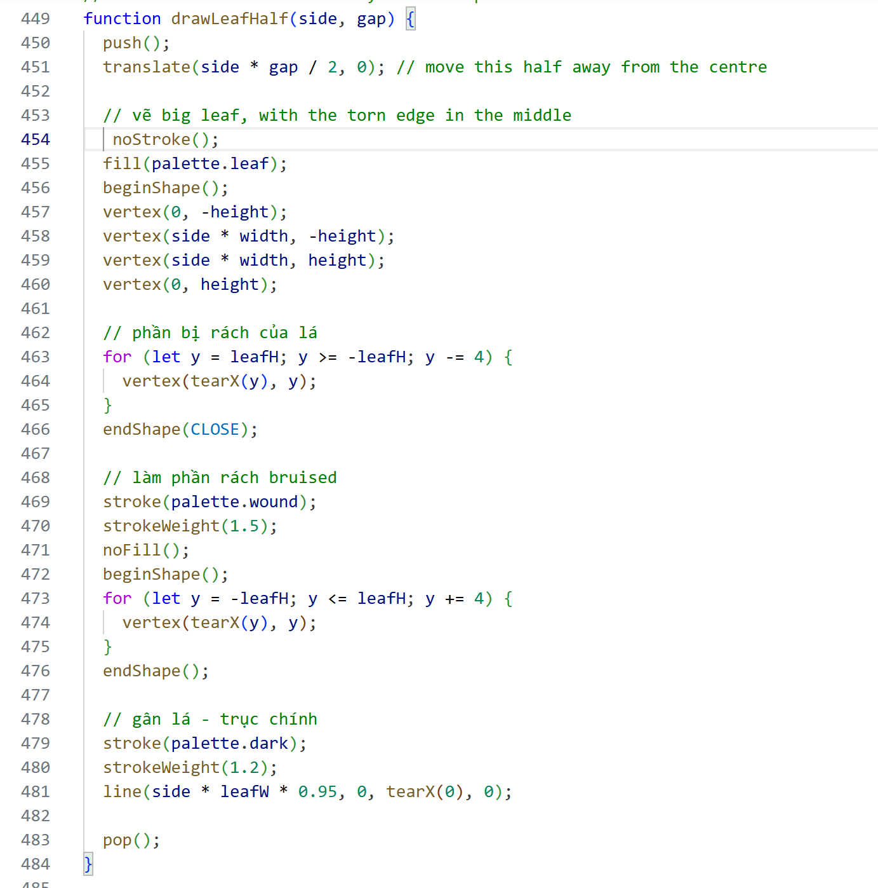<figcaption>Figure: Leaf Function code</figcaption></figure>

***f. Dots in Veins***

This code adds 2–3 moving dots along each vein once it has fully grown. The dots travel from the bubble towards the wound, following the vein and main stem, then loop back. Their movement is controlled by `flowTime`: increasing it moves the dots forward, while pressing **T** sends them backwards. The dots gradually appear as they leave the bubble, then shrink and fade near the wound, creating a healing effect. The maximum dot size is 5.5.

<figure>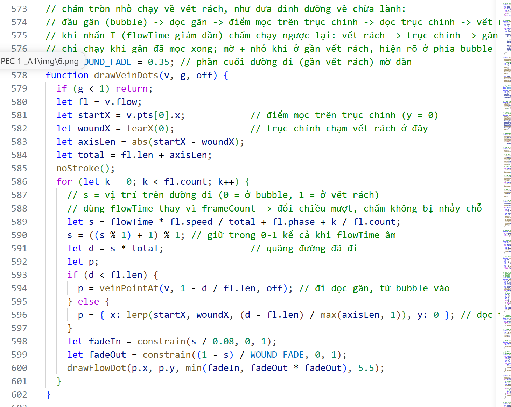<figcaption>Figure: Dot Function code</figcaption></figure>

#### SMOOTH ANIMATION INTERPOLATION

Instead of moving linearly at a constant speed, the animation uses smoothstep to gradually accelerate at the beginning and decelerate toward the end. The formula `x * x * (3 - 2 * x)` is used to produce smooth easing between 0 and 1.

## 8. Sound Design

#### Process
I recorded all the sounds using Dolby On to ensure better audio quality. I also used jsfxr to experiment with creating synthesised sounds. I chose to record at midnight in a four-walled room with minimal background noise to reduce unwanted sounds and create a more controlled recording environment. The recordings turned out a bit differently from Sound 2, as they had quite a lot of clipping, so I had to position the microphone around 20–30 cm away.

After recording, I imported the audio into Audacity for editing. I applied the techniques I had learned in the Sound Design course. I also experimented with EQ, Wahwah, high-pass filters, and other effects to enhance the sound textures, making them feel more engaging and slightly more natural, which better aligns with the concept.

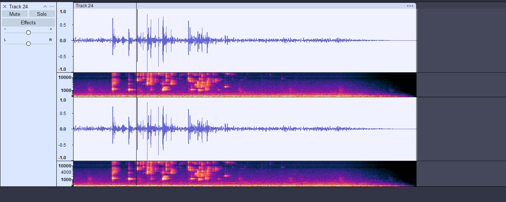
Figure: One of my sounds clipping during recording

#### Sound concept

I wanted to create something soft with a natural, ambient feel. Instead of using pre-made sounds, I experimented with different objects around my house to generate raw audio. I think this approach works much better because some objects sound similar to nature. I tested materials such as metal, plastic, and everyday items to choose the best sounds to move forward with.

Through this process, I focused on finding sounds that feel “triggering” — the kind that immediately catches attention and makes someone instinctively turn back or react. I then selected and refined these sounds to emphasise their rhythmic and repetitive qualities, reinforcing the idea of constant stimulation and interruption.
Overall, the sound design supports the visual concept by creating a subtle sense of tension and control, similar to how notification sounds or short-form content can repeatedly pull users back into the experience.

- Sound 1: When it comes to nature, I always think of the sound of ringing bells. It is cliché, but I think it expresses the soft and calm feeling of nature. The best way to create that sound is through metal and plastic objects. I noticed this sound when metal and plastic hangers hit each other, so I decided to record them. The recorded sound needed careful trimming to keep the echo. Because of the noise in the recording environment, I also used Noise Reduction, Noise Gate, and Compressor.

<figure>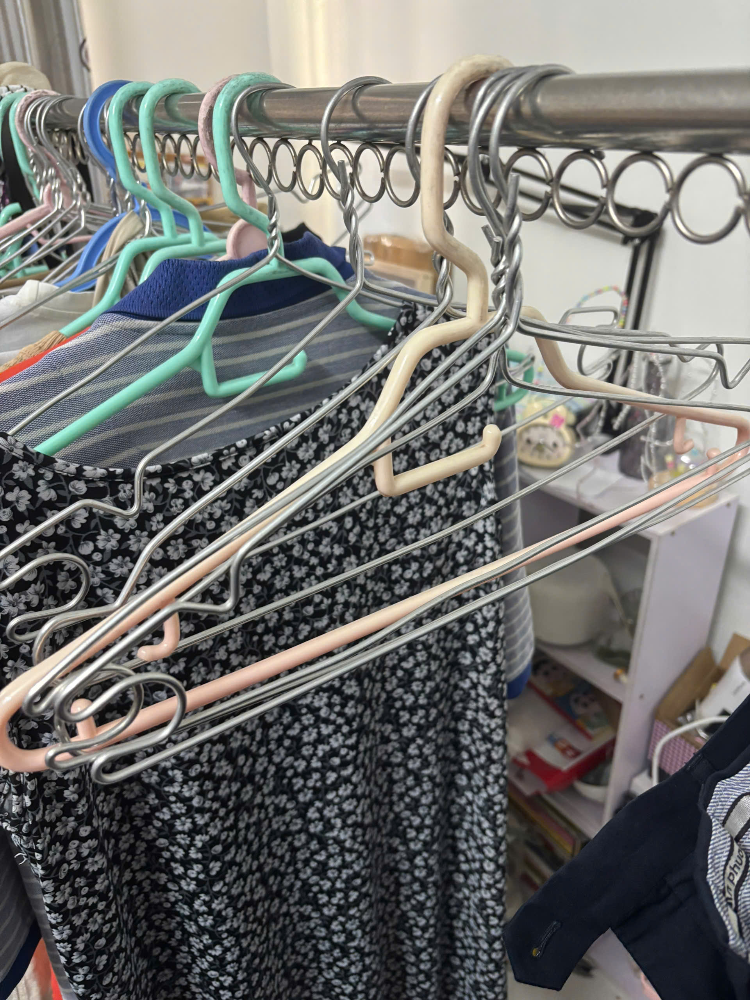<figcaption>Figure: Making Sound</figcaption></figure>
<figure>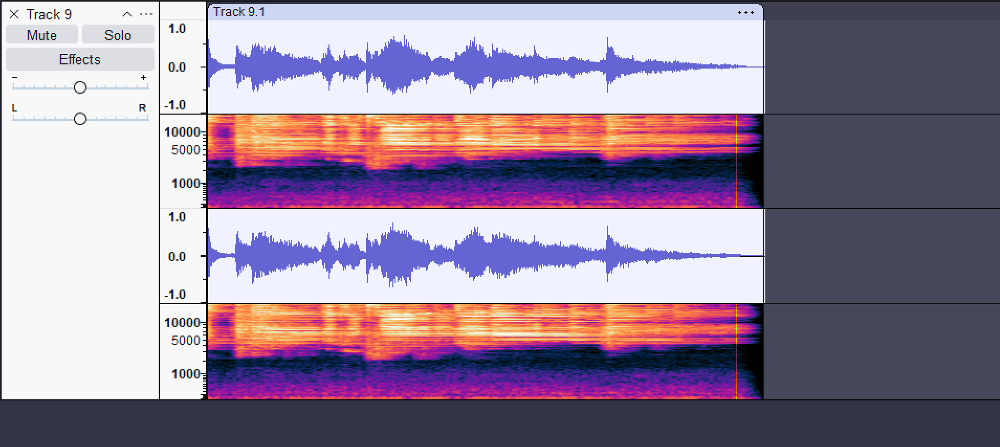<figcaption>Figure: Edited Sound</figcaption></figure>

 

- Sound 2: The sound of water dripping from a small basin. It seems easy to do, but it is the longest sound I have worked on. I don't have experience recording water sounds, so it took me a bit of time to learn how to read the waveform. The sound turned out well after editing, using the techniques I learned and the envelope tool to make the sound less dynamic, as the beginning and the end were louder at first.

<figure>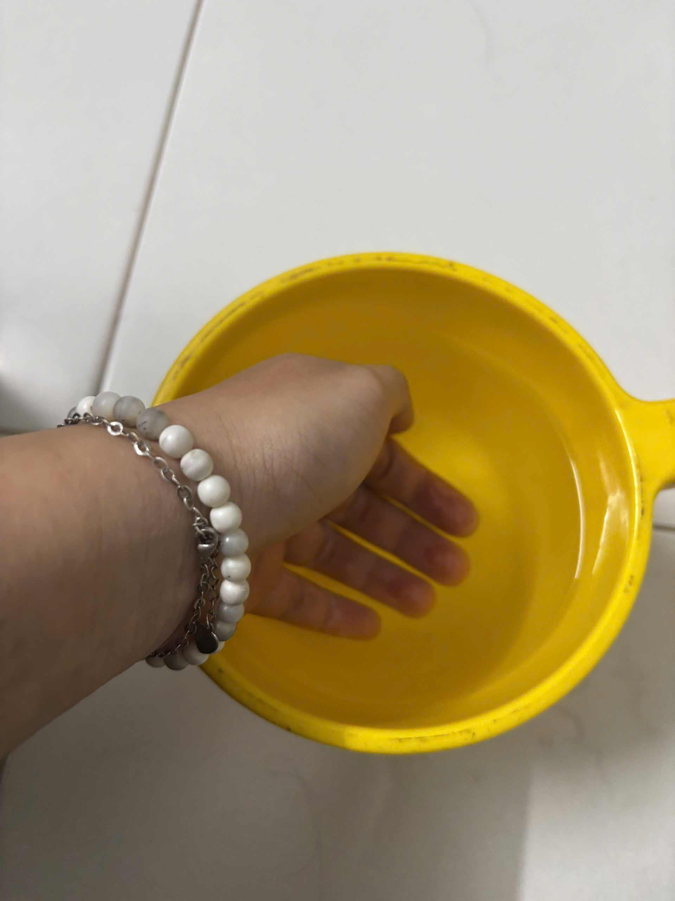<figcaption>Figure: Making Sound</figcaption></figure>
<figure>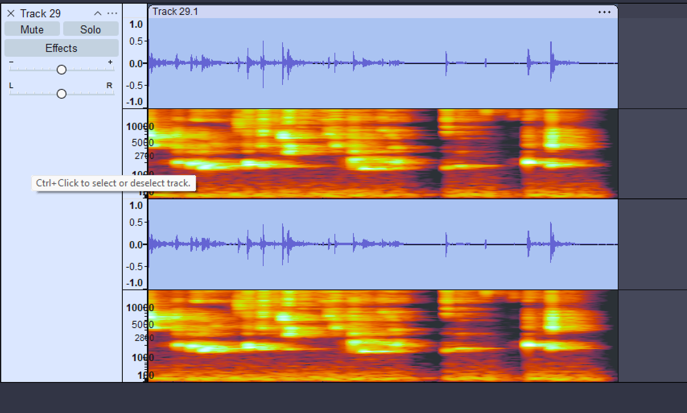<figcaption>Figure: Edited Sound</figcaption></figure>

- Sound 3: This was developed using jsfxr. My intention was to mimic the sound of a bird in nature. I chose a sound with a high pitch and then edited it in Audacity.

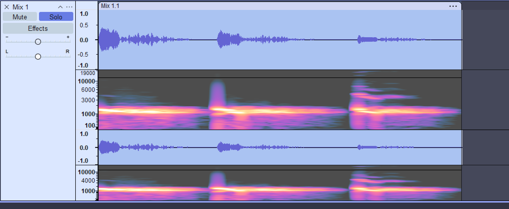
Figure: Edited Sound

#### Sound Testing
My friend recommended GarageBand to me for making sounds, so I tried it out. For someone who only listens to music occasionally, it was a lot to learn, so I just explored it to see what I could do. I think I should learn some music theory, for example from YouTube tutorials, before making music with it. 

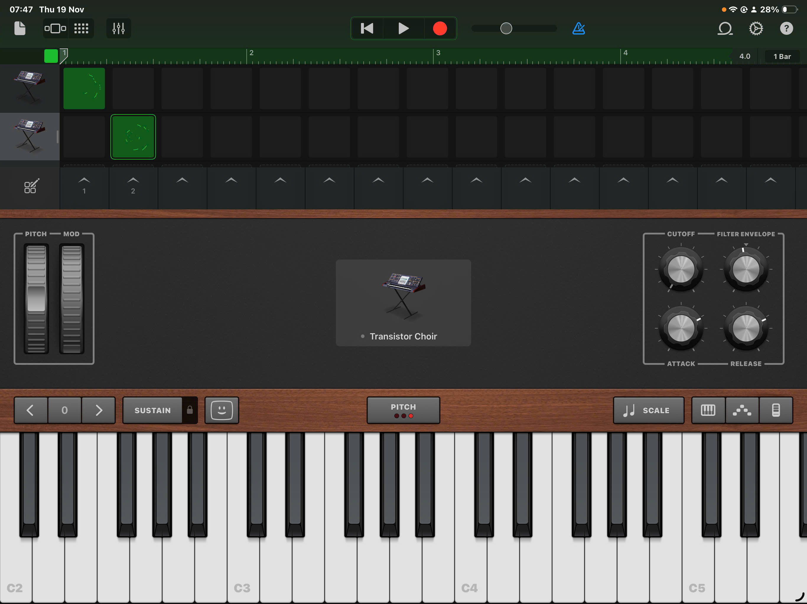
Figure: Playing around with GarageBand
 
##### Key Learning

- Learning Technique

This project uses both AI and my own coding skills. Whenever I come across something I don't know how to do, I ask AI how to change or improve that specific part. It gives me instructions, and I try to follow and implement them by myself. For the parts I don't fully understand, I also ask AI to explain them. I think this is a good balance between using AI as a tool and learning by doing.

Besides building the main structure, I also learned several techniques to improve the visuals and behaviour of the system.

One important technique I learned was **constructing curved branches using sampled points along a Bézier path**. Instead of drawing the whole curve at once, I learned to divide it into smaller segments by calculating points along the path and connecting them step by step. This helped me understand how complex organic shapes can be created through simple mathematical calculations.

I also learned **constraint-based positioning** to control the spatial relationships between elements. For example, I needed to set boundaries for where the veins and twigs could grow so they would stay within the leaf. Through this, I realised that procedural generation is not just about creating random elements, but also about setting rules to control how they grow and behave.

Another technique I learned was **separating visual systems while allowing them to interact**. I developed the leaf veins and bubble elements separately, with their own structures and behaviours. Then, I connected them using shared spatial rules so the veins could stay attached to the moving bubbles. This made the code easier to organise and helped me manage a more complex composition.

Speaking about teamwork, this is the first time we have collaborated, so we have different styles, perspectives, and skills. However, I think each of us has our own strengths that support each other. My teammate, Tien, is good at sound, and I think he is always willing to help me improve my sound-making skills. I am more story-driven, and I encouraged Tien to bring storytelling into our project. Throughout this process, I think we have communicated well and learned how to listen to each other, explain things when there is confusion, and work together to achieve a better outcome. In the next stage, I think we need to put 100% effort into building a strong structure and developing the artworks. We need to connect our two individual works into one complete project, with a consistent vibe, concept, and narrative to express our goal of raising awareness and empathy through SDG 11.

### Reference

Oxford Global (2020) SDG 11 - Sustainable Cities and Communities, YouTube, accessed November 25, 2026. https://www.youtube.com/watch?v=ZkptYd8gsiM

Đào Quỳnh (2024) Greeninvietnam.Org, GREEN IN Việt Nam, accessed November 25, 2026. https://greeninvietnam.org/blogs/blog/phat-trien-ben-vung-la-gi

The Global Goals (2025) Goal 11: Sustainable cities and communities, The Global Goals, accessed November 25, 2026. https://globalgoals.org/goals/11-sustainable-cities-and-communities/

